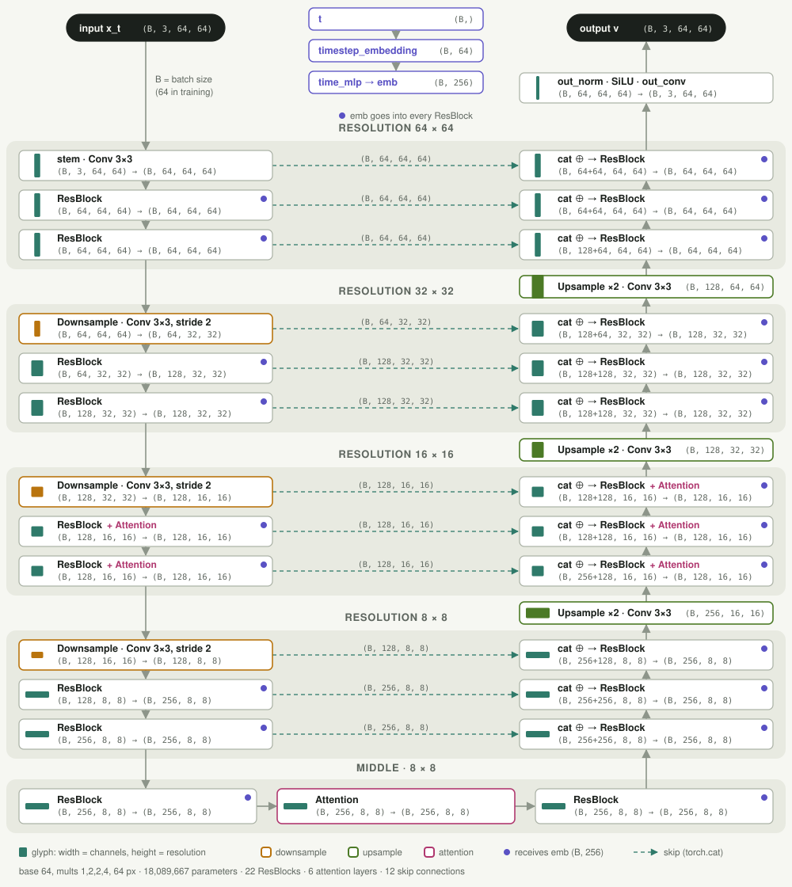

# 🐸 It is Wednesday my dudes – a flow matching frog generator

A small, home-made generative model (rectified flow / flow matching + UNet) that dreams up a beige Wednesday frog at the push of a button. Pixelated and messy on purpose.

## Setup (Mac)
```bash
uv venv .venv.nosync && ln -s .venv.nosync .venv   # ".nosync": keep iCloud away from the venv
source .venv/bin/activate
uv pip install -e '.[data]'          # + '.[clip]' for the frog filter, '.[app]' for the web app
```

## 1. Collect data
Two kinds of images: **memes** (`data/raw/`, the actual goal) and **general frog photos** (`data/pretrain/raw/`, so the
network learns what frogs look like). All sources run through the same filters: website graphics and images below
200 px out, duplicates out (also in other sizes), and with `--clip` additionally everything without a frog (image model
CLIP; rejected images go to `data/rejected/` for review, nothing is deleted).

```bash
uv pip install -e '.[data,clip]'                         # once (CLIP downloads a ~350 MB model)

python scripts/collect.py archive --clip                 # all image posts of the Wednesday subreddits (reddit archive, no login)
python scripts/collect.py inat --n 3000                  # frog/toad photos from iNaturalist
python scripts/collect.py import ~/Desktop/frog --clip   # a folder of your own (chat export, downloads, ...)
python scripts/collect.py dedupe                         # clean duplicates out of data/raw/manual
```
- `archive` uses the public reddit archive **Arctic Shift** to fetch only the post images (no avatars, no ads) from
  r/ItIsWednesday, r/wednesdaymydudes, r/WednesdayFrog, r/ItIsWednesdayMyDudes (`--subreddit` changes the list).
- `inat` downloads research-grade observations of adult frogs and toads with open licences, a third of them from round
  genera (*Breviceps*, *Ceratophrys*, …). Origin and licence are stored in `data/cache/inat_metadata.jsonl`.
- Running again only downloads new things (`data/cache/*.seen`). Images deleted by hand therefore do not come back.
- Formats: JPG, PNG, WebP, GIF, `.jfif`, `.avif`, iPhone `.heic`. Any resolution and aspect ratio.
- Downloading directly from reddit.com (gallery-dl, browser extension) does not work or yields lots of junk – hence `archive`.

## 2. Prepare
```bash
python scripts/prepare.py        # memes: centre square, 64 + 128 px -> data/wednesday-frogs.zip
python scripts/prepare.py --raw data/pretrain/raw --out data/pretrain/processed --zip-name frog-photos
                                 # frog photos -> data/pretrain/frog-photos.zip
```

## 3. Local smoke test
```bash
python train.py --data data/processed/64 --res 64 --base 32 --batch 16 --steps 1500 --warmup 100 --lr 5e-4 \
    --limit 32 --workers 0 --sample-every 500 --out runs/overfit
```
After a few hundred steps, shapes should appear in `runs/overfit/samples/`. Real training belongs on a GPU (Kaggle).

## 4. Train for real (Kaggle/Colab)
1. Upload both zips as Kaggle datasets: `data/wednesday-frogs.zip` as `wednesday-frogs`, `data/pretrain/frog-photos.zip`
   as `frog-photos` (or put both into Google Drive). Both may also live in one dataset.
2. Open `notebooks/train_kaggle.ipynb` (it clones the public repo `alexanderulbrich/wednesday`), switch on GPU and internet,
   run all cells.
3. **Quick prototype first** (its own cell, ~30 min): a smaller network (`--base 32`) with the time budget `--minutes 25`.
   The next cell then creates 16 frogs right away.
   **Big run in the background:** import `notebooks/big_run_kaggle.ipynb`, adjust the parameters at the top,
   *Save Version → Save & Run All (Commit)*. The tab may be closed; the results end up in the version's output.
   The full training runs in two stages, each at 64 px from the sharper 128 px images:
   - **pretrain** on frog photos + memes
   - **fine-tune** on the memes only (`train.py --init …`, smaller learning rate, `--keep-best` keeps the best meme state)
4. A progress bar shows step, loss and remaining time; in addition the log gets a line with `~… left` every 100 steps.
   5 % of the images are held back. Every 1000 steps `train.py` draws `loss.png`: on the left the training loss, on the
   right training vs. validation images (numbers in `metrics.csv`). If the gap between "train (fixed)" and "val" grows on
   the right, the model is memorizing the training images. Explained in `wednesday/monitor.py`.
5. Download `best_frog.pt` from `ft/`.

## Managing models
Put trained models (`frog.pt`, `best_frog.pt` from Kaggle) into the local `models/` folder, naming scheme
`YYYY-MM-DD_<name>_<stage>.pt`, e.g. `2026-11-13_big-b64_ft-best.pt`. Every new model file carries a profile
(date, code version, data, settings, validation loss):
```bash
python -m wednesday.info models/*.pt        # profiles + comparison table
python -m wednesday.info --registry         # write an overview to models/README.md
python generate.py --ckpt latest            # use the newest model from models/
```
Note: a `.pt` file is internally a zip archive. If the browser saves it as `.zip`, just rename it back to `.pt` (in the
terminal – the Finder hides extensions); do not unpack it.

## 5. Push the button
```bash
python generate.py --ckpt frog.pt                  # one frog, opens right away
python generate.py --ckpt frog.pt --n 9 --grid     # grid
python generate.py --ckpt frog.pt --text           # with "IT IS WEDNESDAY MY DUDES"
python generate.py --ckpt frog.pt --steps 3        # extra messy
python generate.py --ckpt frog.pt --temperature 0.95                  # calmer, more typical frogs
python generate.py --ckpt frog.pt --temperature 1.0,0.95,0.9 --n 4    # comparison grid, one row per temperature
```

## App
```bash
uv pip install -e '.[app]'
python app.py            # then open http://127.0.0.1:7860
```
Pick model, seed, steps and temperature, press "▶ Wednesday!" and watch noise turn into a frog. "🎲 8 candidates" shows a
quick preview of 8 random frogs; click one to watch it being generated live. On the right, curves show how the
flow settles: how much the network's guess still changes, how straight the path is, and the trajectory from noise to
image.

## How it works
The code is meant to be read: every file is a chapter with detailed comments. The table of contents is in
`wednesday/__init__.py`. If you only want to understand the principle, read chapter 4 (`wednesday/flow.py`),
5 (`wednesday/model.py`) and 7 (`train.py`).

- **Training:** noise `x0` and image `x1` are mixed linearly, `x_t = (1-t)·x0 + t·x1`. The UNet learns the velocity
  `v = x1 - x0` (MSE loss). `t` is drawn logit-normal, as in SD3.
- **Sampling:** the ODE `dx/dt = v(x, t)` is integrated with Heun or Euler from pure noise (t=0) to the image (t=1).
- Code: `wednesday/flow.py` (loss + sampler), `wednesday/model.py` (UNet), `train.py`, `generate.py`, `app.py`.

### The network
One call of the UNet, unfolded from a U into a ladder: the tensor enters at the top left as `x_t`, goes down the
encoder (the map shrinks, the channels grow), through the middle at 8×8 and back up the decoder to `v` at the top
right. Every dashed line is a skip connection: each encoder row pushes its result onto a stack, and each decoder
ResBlock pops the top entry and concatenates it to its own channels (hence shapes like `256+128`). The time `t` is
turned into one vector `emb` that every ResBlock reads. Attention only runs on the small maps: at 16×16 the 256
positions become 256 tokens with 128 channels each, in the middle 64 tokens with 256 channels.


